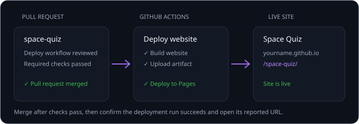

使用 GitHub Pages 部署 Space Quiz，为它创建一个公开访问的网址。Copilot 可以准备工作流并引导部署，但你仍需负责审查更改并确认网站已上线。

本课将介绍如何：

- 让 Copilot 配置 GitHub Pages 部署。
- 在合并前审查工作流和拉取请求。
- 跟进部署并验证已发布的网站。

## 场景

Space Quiz 已在 GitHub 存储库中，但人们还需要一种简单的方式来试用它。使用 GitHub Pages 发布这个单文件网站，可以通过公开 URL 访问它，无需添加服务器或运行时依赖项。

## 让 Copilot 部署网站

在 `space-quiz` 的 Copilot app 会话中发送以下提示：

```plaintext
为此存储库启用 GitHub Pages。创建一个 GitHub Actions 工作流；如有需要，先构建网站，再将其部署到 GitHub Pages。如果存储库中尚无 README，请添加一个，介绍应用以及如何在本地运行它。创建包含这些更改的拉取请求，并在必需检查通过后合并。如果我没有启用 Pages 或合并的权限，请明确告诉我需要批准或执行什么操作；网站实际上线前不要报告成功。
```



> [!WARNING]
> 此提示要求代理创建并合并拉取请求，还要更改存储库的 Pages 设置。继续操作前，请审查差异、部署权限和 GitHub 显示的任何批准提示。

## 审查工作流并验证部署

1. 确认只有在存储库尚无 README 时才添加 README。
2. 审查拉取请求中的更改，包括工作流的构建和部署步骤。
3. 只有必需的拉取请求检查通过后才合并。
4. 跟进 GitHub Actions 部署运行，直到成功。
5. 打开报告中的 URL，确认 Space Quiz 能正常加载。

如果代理无法启用 Pages 或合并拉取请求，请按照它提供的具体说明操作。只有在部署成功且网站可以访问后，才能将任务视为完成。

## 总结和后续步骤

现在 Space Quiz 已作为网站上线，而且你已亲自验证部署结果，而不是只依赖代理的报告。继续[课程 13：审查和后续步骤][next-lesson]。

[next-lesson]: ../13-review/
